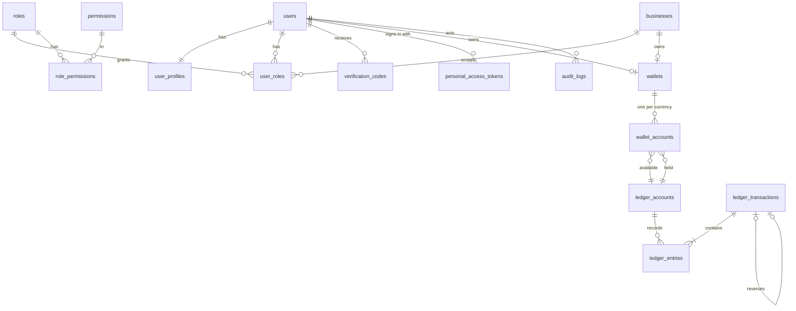

# ERD — milestone 1

Tables implemented in `backend/database/migrations`. Later phases (deposits, withdrawals, cards,
fees, subscriptions, disputes) follow README §9 and attach to `ledger_transactions` via
`source_type` / `source_id`.

Key constraints (Postgres):
- `ledger_entries.amount_minor > 0`, `direction IN ('debit','credit')`
- `wallets`: exactly one of `user_id` / `business_id`
- `ledger_transactions.idempotency_key` unique; `reverses_transaction_id` unique
- Triggers: `ledger_entries_immutable`, `audit_logs_immutable`, deferred `ledger_entries_balanced`
- Money: `bigint` minor units + `char(3)` currency. XAF exponent 0, USD exponent 2.
